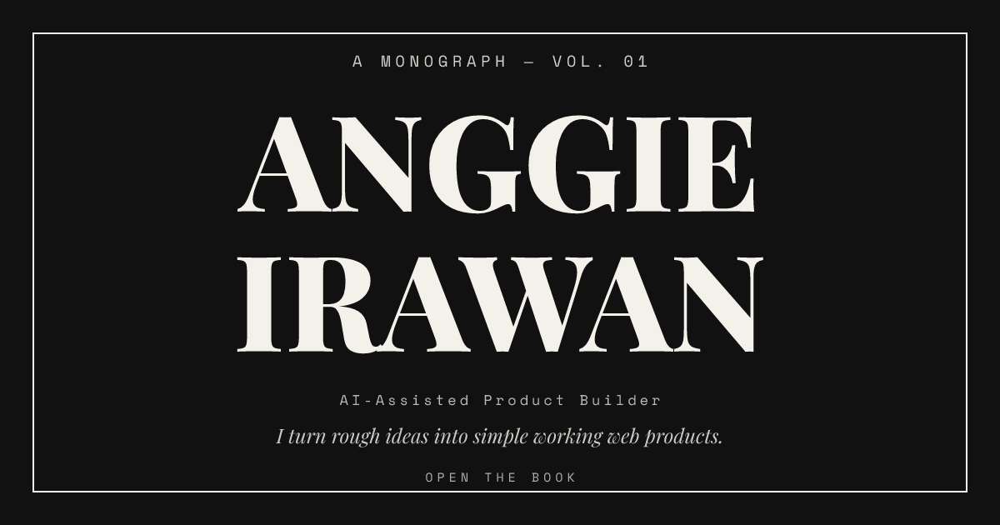

<div align="center">

# Anggie Irawan · Portfolio

**A portfolio you open like a book.**

Four projects, the lessons behind them, and the way I work.

**[Open the live site: anggieirawan.my.id](https://anggieirawan.my.id)**

[](https://nextjs.org)
[](https://react.dev)
[](https://www.typescriptlang.org)
[](LICENSE)
[](https://sonarcloud.io/dashboard?id=eiaiproject_Portofolio)



</div>

## What this is

This is my portfolio. It works like a small hardcover book: the cover opens, pages turn, and each project gets its own two-page spread. I build simple web products for founders, small businesses, and solo makers, and this site shows four of them.

The book stays short on purpose. For each project you see the problem it solves, the lesson I took from it, the stack behind it, and a link to the live product.

## Who I am

I'm Anggie Irawan, an AI-assisted product builder from a non-IT background. Since March 2026 I have been building landing pages, prototypes, dashboards, and small apps, learning by shipping.

AI helps me explore and implement faster. Product decisions, scope, and quality control stay hands-on.

## Inside the book

| Page | What you will find |
| --- | --- |
| Cover and title | The opening spread with my name, role, and the note that sets the tone. |
| About | A short manifesto: where I started and how I work. |
| Work | One spread per project, with the problem, the lesson, the stack, and a link to the live product. |
| Capabilities | Three kinds of work: landing pages and MVPs, internal tools and dashboards, offline-first PWAs. |
| Process | Five steps from idea to ship: share, narrow, build, test, deliver. |
| Contact | A direct email button for project inquiries. |

## The projects

| Project | What it does | Status | Live |
| --- | --- | --- | --- |
| **Expend** | Chat-first offline expense tracker with receipt scanning. | Shipped | [expend.pages.dev](https://expend.pages.dev) |
| **Invois** | Offline-first invoice and receipt maker for freelancers. | Shipped | [invois.pages.dev](https://invois.pages.dev) |
| **Ledjer** | Double-entry bookkeeping for Indonesian small businesses. | Active Development | [ledjer.id](https://ledjer.id) |
| **Kodingu** | Free coding lessons for HTML, CSS, and JavaScript with an in-browser editor. | Shipped | [kodingu.pages.dev](https://kodingu.pages.dev) |

## How to read it

- Click the right page or **Next** to turn forward. Click the left page or **Prev** to go back.
- The arrow keys do the same thing. On a touch screen, swipe left or right.
- Header links jump straight to About, Work, Capabilities, Process, or Contact.
- Every project link opens the live product in a new tab.
- Main pages have direct links: `/#about`, `/#work`, `/#capabilities`, `/#process`, `/#contact`.

## Built with

| Layer | Choice |
| --- | --- |
| Framework | Next.js 15 with the App Router and static export |
| UI | React 19 and TypeScript 5.9 |
| Styling | Custom CSS with design tokens |
| Type | Playfair Display for display, Space Mono for labels, loaded with `next/font` |
| Icons | `reicon-react` |
| Checks | Playwright for visual and functional tests |

The site has no backend and no database. `npm run build` writes a complete static site to `out/`.

The book engine is one controlled component in `components/Book.tsx`. Each sheet is a CSS 3D plane that rotates around the spine. The flip animates the transform only, so the layout stays still. All pages stay in the DOM, so search engines can read the whole book.

## Run locally

You need Node.js 20 or newer.

```bash
git clone https://github.com/eiaiproject/Portofolio.git
cd Portofolio
npm install
npm run dev
```

Open [http://localhost:3000](http://localhost:3000).

For a production build:

```bash
npm run build
npx serve out
```

## Checks

The Playwright suite covers the visual state of every page, keyboard navigation, the mobile menu, touch swipes, link and image basics, console errors, and a smoke test against the live site.

```bash
npx playwright install chromium
npm run audit
```

`npm run audit:update` refreshes the screenshot baselines after an intentional visual change.

GitHub Actions runs `npm ci` and `npm run build` on every push and pull request. SonarCloud checks code quality separately.

## Project layout

| Folder | Contents |
| --- | --- |
| `app/` | Layout, page composition, metadata, and global styles |
| `components/` | Book engine, site header, and every page of the book |
| `lib/` | Project data |
| `public/` | Brand plates, favicon, and share image |
| `tests/audit/` | Playwright visual and functional checks |

`DESIGN.md` holds the design direction and `PRODUCT.md` holds the product context.

## Deploy

The site is a static export, so it runs on any static host. For Cloudflare Pages:

| Setting | Value |
| --- | --- |
| Build command | `npm run build` |
| Output directory | `out` |
| Node.js version | 20 |

No environment variables are required.

## Contact

For project inquiries, use the [contact page](https://anggieirawan.my.id/#contact) on the live site.

## License

MIT. Copyright 2026 Anggie Irawan.
